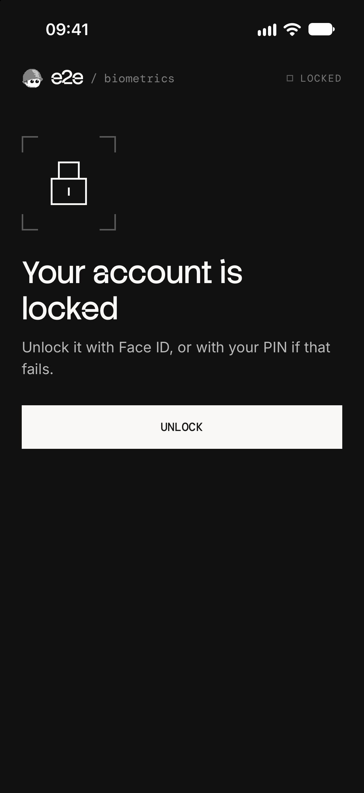

# e2e-biometrics

An Expo lock screen that unlocks with Face ID or a fingerprint and falls back to a PIN, tested end to end on iOS and Android with [e2e](https://www.npmjs.com/package/e2e).



## How it works

- **Unlock** (`src/hooks/use-lock.ts`): asks for Face ID on iOS or a fingerprint on Android through `expo-local-authentication`. The prompt is the system's; the app only learns whether it matched.
- **PIN** (`src/components/pin-form.tsx`): takes over after a failed match, after Use PIN, or at once when nothing is enrolled.
- **Background**: the app locks again as soon as it goes to the background.

The app has its own PIN, like a banking app, so the device's passcode isn't offered as a fallback. The PIN comes from `.env.local` and is built into the app, which is fine for a demo; a real app checks it on its server. There's no backend.

### Faces and fingers

| To play                             | iOS simulator                          | Android emulator                                          |
| ----------------------------------- | -------------------------------------- | --------------------------------------------------------- |
| A match                             | Features → Face ID → Matching Face     | Extended controls → Fingerprint → Finger 1 → Touch sensor |
| A face or finger that doesn't match | Features → Face ID → Non-matching Face | The same with any other finger                            |
| Nothing enrolled                    | Features → Face ID → Enrolled, off     | Not available                                             |

## Getting started

You need Node 22.22.3+ or 24.8+, and Xcode with an iOS simulator that has Face ID or the Android SDK with an emulator ([Expo's setup guide](https://docs.expo.dev/get-started/set-up-your-environment/)).

```bash
npm install
cp .env.example .env.local
npm run ios
```

Set `EXPO_PUBLIC_PIN` in `.env.local` to any 6 digits but `000000`. `npm run ios` (or `npm run android`) builds the app, installs it on the simulator, and starts Metro. The app needs a native build, so it doesn't run in Expo Go.

### Android emulator

Android shows a biometric prompt only on a device with a screen lock, and the tests touch the sensor with finger 1. Set both up once, with the emulator running:

1. Set a screen lock: `adb shell locksettings set-pin 1111`.
2. Open fingerprint setup with `adb shell am start -a android.settings.FINGERPRINT_ENROLL`, enter 1111, and tap through to "Touch the sensor".
3. Touch it with finger 1 until the fingerprint is added, then tap Done:

   ```bash
   for i in $(seq 15); do adb emu finger touch 1; sleep 0.5; adb emu finger remove; sleep 0.5; done
   ```

4. Keep the screen on, so the lock screen stays away during tests: `adb shell svc power stayon true`.

## End-to-end tests

`tests/biometrics.e2e.ts` runs on iOS and Android. A test can't show a face or touch a sensor, so e2e's `device` fixture plays them (`device.setBiometrics`), takes Face ID off the simulator (`device.enrollBiometrics`), and sends the app home and back (`device.home`, `device.openApp`). After a failed match, the agent reads the system's prompt and taps its Use PIN, since iOS and Android word and build it differently. The app's own screens use exact locators, and the PIN is typed as an e2e secret, so it stays out of reports and logs.

| Test                                              | Expects                                                                  |
| ------------------------------------------------- | ------------------------------------------------------------------------ |
| A match unlocks                                   | "Unlocked with Face ID" or "Unlocked with your fingerprint"              |
| A failed match offers the PIN (agent)             | The system says not recognized; a wrong PIN fails, the right one unlocks |
| Nothing enrolled goes straight to the PIN (iOS)   | The PIN field at once, with no prompt                                    |
| The app locks again after going to the background | "Locked when the app went to the background."                            |

The tests need `EXPO_PUBLIC_PIN`, and the agent test also needs a [Vercel AI Gateway](https://vercel.com/docs/ai-gateway) key, `AI_GATEWAY_API_KEY`, both in `.env.local`. Without them they skip. Android has no way to unenroll a fingerprint from a test, so the "nothing enrolled" test runs on iOS only. After `npm run ios` or `npm run android`, run:

```bash
npx e2e run --target ios
npx e2e run --target android
```

Without `--target`, both run, in about a minute and a half and under a cent. The runner starts Metro if it isn't running. To pick the simulator and emulator, or to move Metro off port 8081, set `IOS_DEVICE`, `ANDROID_DEVICE`, or `METRO_PORT` in `.env.local`; build the Android app with `npx expo run:android --port <port>` to match.

## Scripts

| Command             | Description                         |
| ------------------- | ----------------------------------- |
| `npm start`         | Start Metro                         |
| `npm run ios`       | Build and run the app on iOS        |
| `npm run android`   | Build and run the app on Android    |
| `npm run lint`      | Run ESLint                          |
| `npm run typecheck` | Run TypeScript                      |
| `npm run format`    | Format with Prettier                |
| `npm run test:e2e`  | Run the e2e tests on both platforms |
